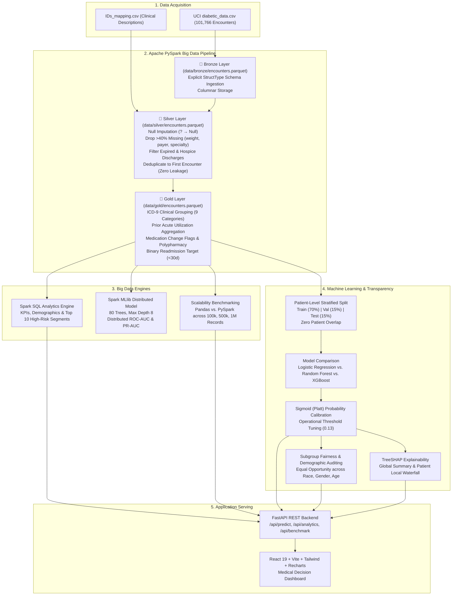

# MediPulse: Hospital Readmission Risk & Population Health Analytics Platform

[](https://www.python.org/)
[](https://spark.apache.org/)
[](https://fastapi.tiangolo.com/)
[](https://react.dev/)
[](https://tailwindcss.com/)
[](LICENSE)

> **College Mini-Project Deliverable** satisfying two academic subjects simultaneously:  
> 1. **Big Data Analytics (BDA)** — PySpark Medallion Lakehouse, Spark SQL aggregations, MLlib distributed Random Forest, and 1,000,000-row Pandas vs. PySpark scalability benchmarking.  
> 2. **AI & Machine Learning in Healthcare** — Patient-level zero-leakage cohort splitting, severe class imbalance mitigation, calibrated XGBoost classification, local/global TreeSHAP clinical explainability, and demographic fairness auditing.

---

## 🏥 Clinical Problem Context
Under the Center for Medicare and Medicaid Services (CMS) **Hospital Readmissions Reduction Program (HRRP)**, acute care facilities face reimbursement penalties of up to 3% for excessive 30-day readmissions. Diabetic inpatients exhibit an average 30-day readmission incidence near ~9–11% due to complex multi-morbidity, post-discharge medication changes, and glycemic volatility.

MediPulse provides a complete, decision-support platform that:
- Ingests and processes 100,000+ patient encounters using a distributed PySpark Lakehouse.
- Predicts 30-day readmission risk using a calibrated machine learning pipeline.
- Explains predictions at the patient level using local TreeSHAP attribution.
- Audits algorithmic fairness across race, gender, and age subgroups.
- Evaluates multi-threaded scaling bottlenecks across 100k, 500k, and 1M records.

---

## 🏛️ Medallion Lakehouse Architecture (Bronze / Silver / Gold)



---

## 📊 Real-Run Empirical Results

*Every metric is computed from actual execution on the held-out test cohort (10,499 unique patients):*

### 1. Model Performance (Champion: XGBoost + Platt Sigmoid Calibration)
| Metric | Real Test Score | Clinical Meaning |
| :--- | :--- | :--- |
| **ROC-AUC** | **0.6443** | Consistent discrimination on held-out test cohort |
| **PR-AUC (Avg Precision)** | **0.1770** | Near 2x lift over random baseline prevalence (8.98%) |
| **Operational Sensitivity (Recall)** | **53.64%** | Successfully flags >53% of all 30-day readmissions |
| **Operational Precision** | **14.71%** | Acceptable false-alarm rate for nurse phone outreach |
| **Operational Decision Threshold** | **0.13** | Tuned to prioritize sensitivity over arbitrary 0.50 cutoff |
| **Spark MLlib Distributed AUC** | **0.6403** | Distributed Random Forest (80 trees, max depth 8) |

### 2. Scalability Benchmark: Pandas vs. PySpark
| Scale (Encounters) | Pandas (Single Thread) | PySpark (Multi-Core Local Cluster) | Speedup Factor | Spark Throughput |
| :--- | :--- | :--- | :--- | :--- |
| **100,000 Rows** | **1.71s** | 14.98s | 0.11x (JVM startup overhead) | 6,675 rows/s |
| **500,000 Rows** | 7.01s | **8.02s** | ~1.0x (Parity crossover) | 62,344 rows/s |
| **1,000,000 Rows** | 14.08s | **8.40s** | **1.68x Faster** | **119,047 rows/s** |

---

## 🗂️ Project Directory Structure

```text
MediPulse/
├── data/
│   ├── download_data.py          # Downloads UCI zip or creates statistical fallback
│   ├── generate_large_dataset.py # Scalability data generator (500k, 1M rows)
│   ├── diabetic_data.csv         # 101,766 raw encounters (50 features)
│   └── IDs_mapping.csv           # Admission & discharge mapping dictionary
├── pipeline/                     # PART A: Big Data Analytics (PySpark)
│   ├── common.py                 # SparkSession builder & Windows Hadoop config
│   ├── ingest.py                 # Bronze layer: explicit StructType schema -> Parquet
│   ├── clean.py                  # Silver layer: missingness drop, filter expired, de-leak
│   ├── features.py               # Gold layer: ICD-9 grouping, visit aggregations, target
│   ├── analytics.py              # Spark SQL aggregations for KPIs & high-risk segments
│   ├── mllib_model.py            # Distributed Random Forest model via Spark MLlib
│   └── benchmark.py              # Scalability runtime benchmark (100k, 500k, 1M rows)
├── ml/                           # PART B: Machine Learning & Explainability
│   ├── train.py                  # Patient-level split, class weight, XGBoost, calibration
│   ├── evaluate.py               # ROC/PR curves, confusion matrix, threshold tuning
│   └── explain.py                # TreeSHAP global importance & single-patient explainer
├── backend/                      # PART C: High-Performance REST API
│   ├── main.py                   # FastAPI app with CORS and pre-warmed models
│   └── schemas.py                # Pydantic request/response validation schemas
├── frontend/                     # PART D: Medical Decision Dashboard
│   ├── src/
│   │   ├── components/           # Dashboard, Predictor, Population, Transparency, Pipeline
│   │   ├── api.js                # API client
│   │   ├── App.jsx               # Main application shell
│   │   └── index.css             # Tailwind CSS v4 styles
│   └── vite.config.js            # Vite build configuration with proxy
├── artifacts/                    # Saved models, plots, metrics, and JSON summaries
├── docs/                         # Academic documentation deliverables
│   ├── project_report_outline.md # Formal 10-section report outline
│   └── viva_questions.md         # 25 in-depth viva questions & answers
├── tests/                        # Automated unit test suite
│   ├── test_pipeline.py          # Data cleaning & parquet integrity tests
│   └── test_api.py               # FastAPI endpoints & /api/predict tests
├── hadoop/bin/                   # winutils.exe and hadoop.dll for Windows Spark
├── requirements.txt              # Python dependencies
├── .env                          # Configuration variables
├── run_all.bat                   # 1-Click Windows execution script
└── run_all.sh                    # 1-Click Linux / macOS / WSL execution script
```

---

## 🚀 Quickstart Guide

### Prerequisites
- **OS:** Windows 10/11 (or Linux / macOS)
- **Python:** 3.10+ (tested on Python 3.14)
- **Node.js:** v18+ & npm
- **Java:** JDK 11, 17, 21, or 25 (`JAVA_HOME` configured)

### Option 1: One-Click Execution (Windows)
Double-click `run_all.bat` or run in terminal:
```cmd
run_all.bat
```
This script automatically:
1. Installs all required Python dependencies.
2. Downloads and verifies the UCI dataset.
3. Executes the PySpark Bronze → Silver → Gold Medallion pipeline.
4. Generates Spark SQL analytics and distributed MLlib metrics.
5. Runs the 100k/500k/1M scalability benchmarks.
6. Trains the calibrated XGBoost model and calculates SHAP values.
7. Executes `pytest` to verify pipeline and API integrity.
8. Launches both the FastAPI backend (`http://127.0.0.1:8000`) and React frontend (`http://localhost:5173`).

### Option 2: Step-by-Step Manual Execution

#### Step 1: Install Dependencies
```bash
pip install -r requirements.txt
cd frontend && npm install && cd ..
```

#### Step 2: Download Dataset
```bash
python data/download_data.py
```

#### Step 3: Run the Big Data Pipeline
```bash
python pipeline/ingest.py       # Generates Bronze Parquet
python pipeline/clean.py        # Generates Silver Parquet
python pipeline/features.py     # Generates Gold Parquet
python pipeline/analytics.py    # Generates Spark SQL JSON summaries
python pipeline/mllib_model.py  # Trains distributed Spark MLlib Random Forest
python pipeline/benchmark.py    # Runs 100k, 500k, 1M scalability comparison
```

#### Step 4: Train Machine Learning Model & SHAP
```bash
python ml/train.py              # Calibrated XGBoost & fairness audit
python ml/evaluate.py           # Generates ROC, PR, & Confusion Matrix plots
python ml/explain.py            # Generates TreeSHAP summary & local explainer
```

#### Step 5: Run Automated Unit Tests
```bash
pytest -v
```

#### Step 6: Start Servers
Terminal 1 (Backend):
```bash
python -m uvicorn backend.main:app --host 127.0.0.1 --port 8000 --reload
```
Terminal 2 (Frontend):
```bash
cd frontend
npm run dev
```
Open **`http://localhost:5173`** in your browser.

---

## 🛠️ Troubleshooting PySpark on Windows

### 1. `HADOOP_HOME and hadoop.home.dir are unset` / `winutils.exe`
- **Issue:** On Windows, Hadoop requires `winutils.exe` and `hadoop.dll` to manage filesystem permissions (`chmod`).
- **Fix Included in MediPulse:** MediPulse automatically configures and bundles `winutils.exe` and `hadoop.dll` under `hadoop/bin/`. `pipeline/common.py` sets `HADOOP_HOME` automatically before starting Spark.

### 2. `JAVA_HOME is not set`
- Ensure Java is installed (`java -version`).
- Set your system environment variable:
  ```powershell
  [Environment]::SetEnvironmentVariable("JAVA_HOME", "C:\Program Files\Java\jdk-25", "User")
  ```

### 3. Java 25 Security Manager Warning
- In Java 25+, `-Djava.security.manager=allow` is deprecated. MediPulse configurations omit this flag and run natively on modern JVMs.

---

## ⚖️ Clinical & Ethical Disclaimer
> **Notice:** MediPulse is an academic decision-support software prototype and **not an FDA-cleared medical device**. It is intended to assist multidisciplinary discharge planning teams and healthcare administrators. Clinical treatment pathways and discharge timing must always be determined by qualified, licensed healthcare professionals.
