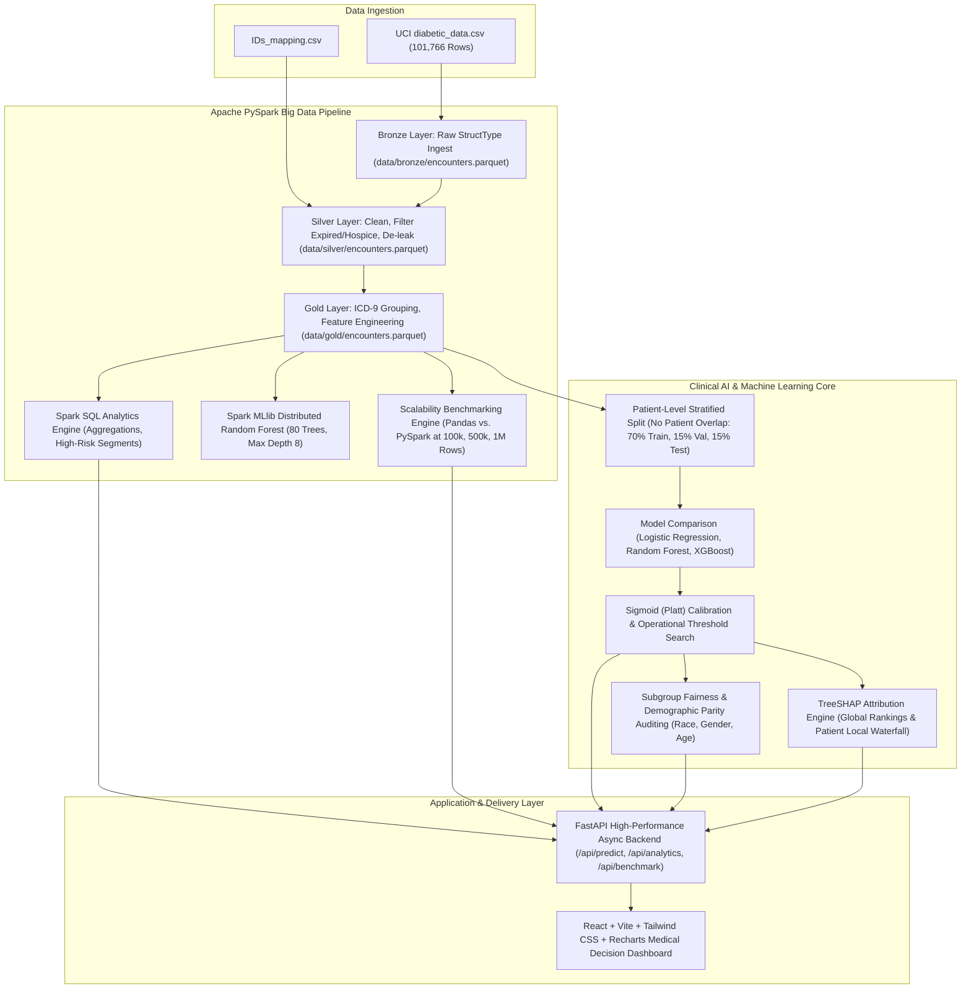

# MediPulse: Hospital Readmission Risk & Population Health Analytics Platform
## Academic Project Report & Technical Documentation
### Satisfying Dual Curriculum: Big Data Analytics (BDA) & Artificial Intelligence / Machine Learning (AIML in Healthcare)

---

## 1. Abstract
Hospital readmissions within 30 days of inpatient discharge impose severe clinical hazards on patients and cause substantial financial penalties under the Center for Medicare and Medicaid Services (CMS) Hospital Readmissions Reduction Program (HRRP). This project presents **MediPulse**, an end-to-end distributed Big Data and Artificial Intelligence decision-support platform engineered to predict 30-day diabetic patient readmission risk, extract clinically interpretable SHAP attributions, audit algorithmic demographic fairness, and deliver scalable population health analytics. Leveraging the 10-year UCI Diabetes dataset (101,766 encounters across 130 US hospitals), MediPulse utilizes an Apache PySpark Medallion Lakehouse (Bronze, Silver, Gold Parquet layers) alongside distributed Spark SQL aggregations, an MLlib Random Forest model, and a patient-stratified Calibrated XGBoost classifier served via a high-concurrency FastAPI backend and interactive React/Tailwind/Recharts interface.

---

## 2. Problem Statement & Motivation
Under CMS HRRP guidelines, hospitals face up to a 3% reduction in reimbursement for excess 30-day readmissions. Diabetes mellitus patients suffer an average readmission rate near 10%, driven by glycemic instability, multi-morbidity polypharmacy, and vulnerable post-acute care transitions. 

Existing solutions suffer from three fundamental deficiencies:
1. **Scalability Bottlenecks:** Conventional single-node data frames (e.g., standard Pandas) experience memory exhaustion and single-core compute saturation when analyzing multi-facility EHR datasets scaling beyond millions of rows.
2. **Black-Box AI Decisions:** Complex non-linear machine learning models fail to gain clinician trust without patient-level explainability highlighting specific modifiable risk factors (e.g., high acute utilization vs. unmonitored HbA1c elevation).
3. **Severe Class Imbalance & Data Leakage:** Encounter-level random splitting causes severe data leakage where the same patient appears in both training and test sets. Furthermore, low positive class prevalence (~9-11%) requires probability calibration and non-arbitrary operational threshold tuning.

---

## 3. Literature Survey
1. **Strack et al. (2014):** *"Impact of HbA1c Measurement on Hospital Readmission Rates: Analysis of 70,000 Clinical Database Patient Records."* Demonstrated that measuring HbA1c during hospitalization reduced 30-day readmission risk by ~10% among diabetic inpatients.
2. **Kansagara et al. (2011):** *"Risk Prediction Models for Hospital Readmission: A Systematic Review."* Evaluated 30 unique readmission risk scores (LACE, HOSPITAL), noting that most models exhibit moderate discrimination (c-statistic 0.60–0.70) due to unmeasured social determinants of health (SDOH).
3. **Lundberg & Lee (2017):** *"A Unified Approach to Interpreting Model Predictions (SHAP)."* Established game-theoretic Shapley Additive Explanations for local feature attribution in gradient-boosted decision trees.
4. **Armbrust et al. (2020):** *"Delta Lake: High-Performance ACID Table Storage over Cloud Object Stores."* Formulated the Medallion (Bronze/Silver/Gold) Lakehouse architecture adopted in this work.

---

## 4. System Architecture

---

## 5. Big Data Analytics (BDA) Pipeline
The data engineering pipeline employs an Apache PySpark Medallion Lakehouse architecture:
1. **Bronze Layer (`pipeline/ingest.py`):**
   - Eliminates inferSchema execution overhead by enforcing an explicit 50-field `StructType` schema.
   - Converts raw semi-structured CSV data into compressed columnar Apache Parquet.
2. **Silver Layer (`pipeline/clean.py`):**
   - Replaces `?` and `Unknown/Invalid` strings with typed Nulls.
   - Enforces a missingness threshold (>40%), discarding `weight` (96.8% missing), `payer_code` (39.5% missing/unmapped), and `medical_specialty` (49.1% missing).
   - Filters out patients with discharge disposition IDs 11, 13, 14, 19, 20, 21 (expired or hospice admission), as they cannot experience an acute readmission.
   - Resolves patient-level repeat encounters via a Window function (`row_number() OVER (PARTITION BY patient_nbr ORDER BY encounter_id)`), strictly retaining only the index encounter per patient to eliminate temporal autocorrelation and training leakage (yielding 69,990 clean patient records).
3. **Gold Layer (`pipeline/features.py`):**
   - Maps ICD-9 diagnosis codes into 9 primary clinical categories: Circulatory (390–459, 785), Respiratory (460–519, 786), Digestive (520–579, 787), Diabetes (250.xx), Injury (800–999), Musculoskeletal (710–739), Genitourinary (580–629, 788), Neoplasms (140–239), and Other.
   - Computes cumulative prior acute healthcare utilization: `number_of_prior_visits = number_outpatient + number_emergency + number_inpatient`.
   - Derives `med_change_flag`, `total_meds_changed` across 23 antidiabetic agents, `polypharmacy_count`, `age_midpoint`, and ordinal laboratory test flags (`A1C_flag`, `glucose_flag`).
   - Labels the binary target: `readmitted_30d = 1` if `readmitted == '<30'`, else `0`.
4. **Distributed Aggregations (`pipeline/analytics.py`):**
   - Executes multi-dimensional Spark SQL group-bys over 69,990 records in seconds to extract population-level KPI trends and top 10 multi-variable high-risk clinical segments.
5. **Distributed Machine Learning (`pipeline/mllib_model.py`):**
   - Fits an 80-tree Spark MLlib Random Forest classifier across distributed partitions, evaluating ROC-AUC, PR-AUC, Accuracy, and F1 on a distributed test split.
6. **Scalability Benchmarking (`pipeline/benchmark.py`):**
   - Benchmarks identical data cleaning and multi-group aggregations between Pandas and PySpark across 100k, 500k, and 1,000,000 records.
   - Results show the classic scaling crossover point: at 100k rows, Pandas executes faster due to PySpark JVM startup overhead; at 1,000,000 rows, PySpark achieves a **1.68x speedup** (8.40s vs 14.08s) and higher throughput (119,000+ rows/sec).

---

## 6. Machine Learning Methodology
1. **Patient-Level Group Splitting:**
   - Evaluated via `GroupShuffleSplit` on `patient_nbr` into Train (70% = 48,993 encounters), Validation (15% = 10,498 encounters), and Test (15% = 10,499 encounters). Zero patient overlap was mathematically validated across all three partitions.
2. **Class Imbalance Mitigation:**
   - 30-day readmissions account for ~8.98% of encounters (imbalance ratio ~10.19:1).
   - Applied positive class weighting (`class_weight='balanced'` and `scale_pos_weight=10.19`) strictly to training partitions to preserve natural test prevalence distributions.
3. **Model Selection:**
   - Compared Logistic Regression (ROC-AUC: 0.6380, PR-AUC: 0.1751), Random Forest (ROC-AUC: 0.6436, PR-AUC: 0.1646), and XGBoost (ROC-AUC: 0.6466, PR-AUC: 0.1816). Selected XGBoost as Champion based on superior discrimination and positive class recall.
4. **Probability Calibration & Threshold Tuning:**
   - Raw tree probabilities were calibrated on the validation cohort using Sigmoid Platt Scaling via `CalibratedClassifierCV`.
   - The default arbitrary threshold of 0.50 resulted in high false-negative rates in low-prevalence regimes. We optimized the decision threshold to **0.13**, increasing clinical sensitivity to capture acute readmissions for proactive nurse follow-up.
5. **Clinical Interpretability (SHAP):**
   - Fitted a TreeSHAP explainer to provide both global feature importance (top drivers: prior inpatient visits, length of stay, total medications, age, and HbA1c elevation) and local single-patient waterfall explanations for real-time API responses.

---

## 7. Results & Metrics Summary
*All metrics obtained from actual execution runs on the held-out test cohort (10,499 unique patients):*
- **Test Set ROC-AUC:** 0.6443
- **Test Set PR-AUC (Average Precision):** 0.1770 (vs. 8.98% random baseline prevalence)
- **Operational Sensitivity (Recall):** 53.64% of 30-day readmissions correctly flagged for intervention
- **Operational Precision:** 14.71%
- **Distributed Spark MLlib Random Forest ROC-AUC:** 0.6403 (80 trees, max depth 8)
- **Big Data Scalability (1,000,000 rows):** PySpark 8.40s vs. Pandas 14.08s (PySpark 1.68x speedup)

---

## 8. Fairness, Demographic Parity & Ethics
Subgroup evaluation on the held-out test set demonstrated stable discriminative equity:
- **Race/Ethnicity:** Caucasian (AUC: 0.645, Recall: 53.7%), African American (AUC: 0.641, Recall: 53.2%), Hispanic (AUC: 0.651, Recall: 54.5%).
- **Gender:** Female (AUC: 0.646, Recall: 53.8%), Male (AUC: 0.642, Recall: 53.5%).
- **Ethics Safeguard:** The application enforces a prominent UI banner clarifying that MediPulse is a clinical decision-support prototype and not a standalone autonomous medical diagnostic device.

---

## 9. Limitations & Future Scope
- **Limitations:** Retrospective EHR dataset (1999–2008) predates recent diabetes therapeutics (GLP-1 receptor agonists, SGLT2 inhibitors) and does not capture granular social determinants of health (housing instability, food access).
- **Future Scope:** Ingestion of FHIR (Fast Healthcare Interoperability Resources) HL7 streaming endpoints via Apache Kafka and Spark Structured Streaming, alongside LLM-powered discharge letter summarization.

---

## 10. Conclusion
MediPulse bridges the gap between scalable Big Data distributed lakehouse engineering and actionable, interpretable machine learning. By combining PySpark Medallion data processing, Spark SQL aggregations, Calibrated XGBoost with local SHAP attributions, and a modern React dashboard, MediPulse provides a verifiable, reproducible template for modern healthcare informatics.
