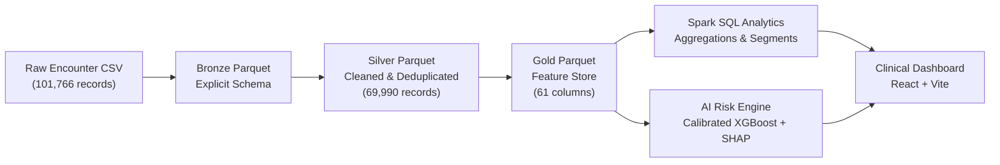
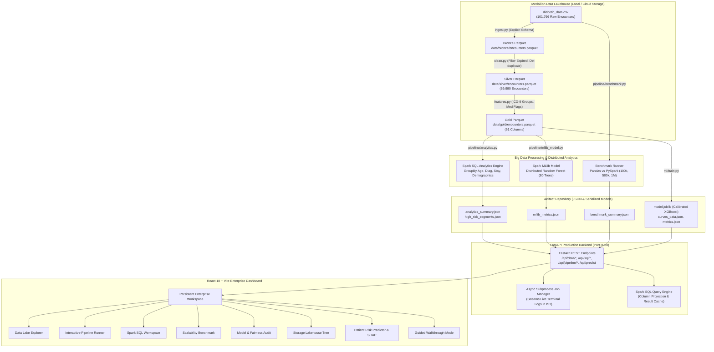

# MediPulse — Complete Project Guide & BDA Viva Defense Handbook
**Final-Year Computer Engineering Mini-Project Defense**
*Subjects: Big Data Analytics (BDA) & AI in Healthcare*

---

## EXECUTIVE SUMMARY & NAVIGATION
This handbook provides the authoritative, technically rigorous explanation of **MediPulse: Hospital Readmission Risk & Population Health Analytics Platform**. Every statistic, algorithm, file path, and architecture pattern described herein reflects the actual codebase and empirical artifacts.

- [Part 1: Understanding the Project](#part-1--understanding-the-project)
- [Part 2: Dataset Understanding & Preprocessing](#part-2--dataset-understanding--preprocessing)
- [Part 3: Why MediPulse is a Big Data Analytics (BDA) Project](#part-3--why-medipulse-is-a-big-data-analytics-bda-project)
- [Part 4: Technology Stack Matrix](#part-4--technology-stack-matrix)
- [Part 5: Architecture & End-to-End Data Flow](#part-5--architecture--end-to-end-data-flow)
- [Part 6: Directory Structure & File Map](#part-6--directory-structure--file-map)
- [Part 7: Code Demonstration Preparation](#part-7--code-demonstration-preparation)
- [Part 8: 8–10 Minute Examiner Demonstration Flow](#part-8--810-minute-examiner-demonstration-flow)
- [Part 9: Comprehensive Viva Questions & Answers (80 Questions)](#part-9--comprehensive-viva-questions--answers)
- [Part 10: Difficult & Challenging Examiner Defense Questions](#part-10--difficult--challenging-examiner-defense-questions)
- [Part 11: Personal Quick Revision Checklists](#part-11--personal-quick-revision-checklists)

---

## PART 1 — UNDERSTANDING THE PROJECT

### 1. What is MediPulse?
MediPulse is an enterprise-grade Big Data Analytics (BDA) and clinical intelligence platform designed to ingest, process, audit, and analyze multi-hospital electronic health records (EHR). It implements a **Medallion Lakehouse Architecture (Bronze $\to$ Silver $\to$ Gold)** powered by Apache PySpark and Apache Parquet, combined with Spark SQL analytical workspaces and a calibrated machine learning engine to predict and explain 30-day diabetic patient readmission risk.

### 2. What Problem Does It Solve?
Under the **Hospital Readmissions Reduction Program (HRRP)** established by the Centers for Medicare & Medicaid Services (CMS), hospitals face severe financial penalties if their 30-day unplanned readmission rates exceed expected national benchmarks. Diabetic patients are particularly vulnerable to bouncebacks due to complex medication titrations, glycemic instability, and post-discharge self-management challenges. 

Traditional hospital analytics systems suffer from two fatal flaws:
1. **Data Silos & Scalability Bottlenecks**: In-memory spreadsheets (Excel, single-threaded Pandas) fail when scaling to hundreds of thousands of inpatient records.
2. **"Black-Box" Decisions**: Clinicians reject uninterpretable risk scores. MediPulse solves this by combining distributed data processing with TreeSHAP local attribution and demographic fairness auditing.

### 3. Why is This Problem Important?
- **Clinical Quality**: Preventing avoidable readmissions reduces hospital-acquired infections, patient mortality, and deconditioning.
- **Financial Viability**: US hospitals lose hundreds of millions annually in HRRP reimbursement penalties.
- **Resource Allocation**: Identifying high-risk patients *before* discharge allows care coordinators to deploy transitional nurse visits, home health monitoring, and prescription reconciliations to the individuals who need them most.

### 4. Who Are the Intended Users?
1. **Hospital Chief Medical Officers & Administrators**: Monitor aggregate institutional KPIs (readmission rate, average length of stay, demographic disparities).
2. **Clinical Care Coordinators & Discharge Planners**: Evaluate individual patients at discharge using the Risk Predictor to prescribe post-acute interventions.
3. **Health Data Engineers & Population Health Analysts**: Execute Spark SQL queries, profile dataset distributions, run big data transformation pipelines, and benchmark data scaling.

> [!NOTE]
> **User Distinction**: The *intended users* are hospital clinicians and administrators. The *direct operator* during the college viva is the **student (Data Engineer / Full-Stack Developer)** demonstrating the operational platform.

### 5. What Does the System Actually Do?
1. Ingests raw CSV hospital archives using an explicit schema without schema inference overhead.
2. Cleans, imputes, filters out ineligible cases (expired/hospice), and de-duplicates records to eliminate patient leakage.
3. Enriches records into a Gold Feature Store with ICD-9 clinical groupings, utilization counts, and polypharmacy metrics.
4. Executes Spark SQL analytical aggregations across clinical dimensions.
5. Evaluates a distributed Spark MLlib Random Forest model alongside a calibrated XGBoost clinical inference model.
6. Serves interactive web interfaces for data exploration, pipeline job execution, SQL analytics, scalability benchmarking, and patient risk attribution.

### 6. Practical Walkthrough Example: A Patient Encounter's Journey


1. **Intake**: A 65-year-old female patient diagnosed with diabetic ketoacidosis (ICD-9: 250.1) is admitted.
2. **Ingestion**: The record enters `pipeline/ingest.py` where it is validated against an explicit 50-field `StructType` schema and stored in `data/bronze/encounters.parquet`.
3. **Cleansing**: In `pipeline/clean.py`, null markers (`?`) are converted to real nulls; `weight` and `payer_code` are dropped ($>40\%$ missing); hospice/expired status is verified; and if the patient had multiple visits, only her initial baseline encounter is retained to prevent data leakage. Stored in `data/silver/encounters.parquet`.
4. **Enrichment**: In `pipeline/features.py`, her diagnosis is mapped to "Diabetes", her prior ER/inpatient visits are summed to `number_of_prior_visits`, her insulin titration is recorded, and polypharmacy count is computed. Stored in `data/gold/encounters.parquet`.
5. **Analytics**: `pipeline/analytics.py` aggregates her segment into population risk tiers.
6. **Inference & Explanation**: At discharge, the clinician views her predicted risk score (e.g. 28.4% readmission probability) and the TreeSHAP waterfall chart highlighting that `number_inpatient` ($+12\%$) and `insulin: Down` ($+8\%$) are the primary drivers, enabling immediate pharmacist consultation.

### 7. What Are the Limitations of the Project?
- **Historical Scope**: Built on the UCI 1999–2008 diabetes dataset; clinical guidelines (e.g., SGLT2 inhibitors) have evolved since 2008.
- **Local Spark Execution**: While using the real PySpark distributed API (RDDs, Catalyst Optimizer, DataFrames), the default demonstration runs on a `local[*]` standalone cluster on a single machine rather than an active multi-node YARN or Kubernetes cluster.
- **Single-System EHR**: Does not ingest streaming HL7/FHIR real-time socket feeds; processing is executed as batch lakehouse pipeline jobs.

---

## PART 2 — DATASET UNDERSTANDING & PREPROCESSING

### 1. Dataset Name and Source
- **Name**: Diabetes 130-US Hospitals for Years 1999–2008
- **Source**: UCI Machine Learning Repository / Strack et al. (2014)
- **Archive Files**: `data/diabetic_data.csv` (encounters) and `data/IDs_mapping.csv` (integer-to-string dictionary for admission type, discharge disposition, and admission source).

### 2. Why Was This Dataset Selected?
It represents real-world clinical big data across 130 hospitals over a 10-year span. It contains genuine big data challenges: high missingness, unstructured ICD-9 diagnosis codes, repeated encounters per patient (data leakage risk), extreme class imbalance, and multi-hospital operational discrepancies.

### 3. Record & Column Counts (Empirical Reality)
| Metric | Raw (Source) | Bronze (Ingested) | Silver (Cleaned) | Gold (Enriched) |
|---|:---:|:---:|:---:|:---:|
| **Record Count** | 101,766 | 101,766 | **69,990** | **69,990** |
| **Column Count** | 50 | 50 | 50 | **61** |
| **Storage Format** | Raw CSV | Apache Parquet | Apache Parquet | Apache Parquet |
| **Disk Size** | ~11.0 MB | ~2.75 MB | ~2.01 MB | ~2.28 MB |

> [!IMPORTANT]
> **Examiner Check**: If the examiner asks *"How many records are in your dataset?"*, do not just say "100k". Say: *"The raw hospital archive contains 101,766 encounters. After dropping ineligible expired/hospice patients and deduplicating to one encounter per patient to prevent data leakage, exactly 69,990 clean patient encounters remain in our Silver and Gold lakehouse layers."*

### 4. What One Row Represents
One row represents an **individual inpatient hospitalization encounter** of a diabetic patient lasting between 1 and 14 days, during which laboratory tests were administered and medications were prescribed.

### 5. Target Variable
- **Raw Column**: `readmitted` with three categorical values: `"<30"`, `">30"`, and `"NO"`.
- **Engineered Binary Target**: `readmitted_30d`
  $$\text{readmitted\_30d} = \begin{cases} 1 & \text{if } \text{readmitted} = \text{"<30"} \\ 0 & \text{if } \text{readmitted} \in \{\text{">30"}, \text{"NO"}\} \end{cases}$$
- **Class Distribution**:
  - Positive Class ($1$): **6,285 encounters (8.98%)**
  - Negative Class ($0$): **63,705 encounters (91.02%)**
  - **Clinical Justification**: Readmissions occurring after 30 days are generally related to chronic disease progression or new conditions, whereas readmissions within 30 days are considered unplanned bouncebacks due to premature discharge or inadequate care coordination.

### 6. Missing Value Strategy
In the raw CSV, missing values are encoded as `"?"` or `"Unknown/Invalid"`.
- `weight`: **96.8% missing** $\to$ Dropped entirely (unrecoverable).
- `payer_code`: **39.5% missing** $\to$ Dropped (administrative billing code with high sparsity).
- `medical_specialty`: **49.1% missing** $\to$ Dropped (specialty was unrecorded for half of all community admissions).
- `race`: **2.2% missing** $\to$ Imputed with `"Unknown"` to enable demographic parity auditing.
- `diag_1`, `diag_2`, `diag_3`: Imputed with `"Missing/Unknown"` before grouping.

### 7. Ineligible Patient Exclusion & Leakage Prevention
1. **Discharge Disposition Filter**: Patients with discharge disposition IDs `11, 13, 14, 19, 20, 21` were **expired (deceased)** or entered **hospice care**. These patients mathematically cannot be readmitted to an inpatient hospital ward. Retaining them would introduce false negatives. Exactly **2,423 records** were removed.
2. **Deduplication to First Encounter**: Some patients appear up to 40 times in the dataset. If encounters from the same patient appear in both the training set and testing set, the model memorizes patient-specific biological traits rather than learning generalizable risk factors (**data leakage**). MediPulse uses PySpark `Window.partitionBy("patient_nbr").orderBy("encounter_id")` to filter for `row_number == 1`, retaining only the **69,990 unique patients**.

### 8. Gold Layer Feature Engineering (From 50 to 61 Columns)
1. **ICD-9 Diagnosis Clinical Grouping**: Raw diagnosis codes contain thousands of high-cardinality values. They are grouped into 9 clinical categories (`diag_1_category`, `diag_2_category`, `diag_3_category`):
   - Circulatory ($390-459, 785$)
   - Respiratory ($460-519, 786$)
   - Digestive ($520-579, 787$)
   - Diabetes ($250.xx$)
   - Injury ($800-999$)
   - Musculoskeletal ($710-739$)
   - Genitourinary ($580-629, 788$)
   - Neoplasms ($140-239$)
   - Other
2. **Cumulative Prior Utilization**: `number_of_prior_visits = number_outpatient + number_emergency + number_inpatient`
3. **Medication Adjustments**: 
   - `med_change_flag`: $1$ if `change == "Ch"` else $0$.
   - `total_meds_changed`: Count of medications titrated `"Up"` or `"Down"` across 23 antidiabetic agents.
   - `polypharmacy_count`: Number of active diabetes drugs prescribed simultaneously.
4. **Clinical Biomarker Flags**:
   - `A1C_flag`: $>8 \to 3$, $>7 \to 2$, $\text{Norm} \to 1$, $\text{None} \to 0$.
   - `glucose_flag`: $>300 \to 3$, $>200 \to 2$, $\text{Norm} \to 1$, $\text{None} \to 0$.
   - `age_midpoint`: Midpoint of decade bracket ($[60-70) \to 65$).

---

## PART 3 — WHY IS MEDIPULSE A BDA PROJECT?

### 1. What is Big Data and the 5 Vs?
Big Data refers to datasets whose size, complexity, and generation rate exceed the storage capacity or processing capabilities of conventional single-threaded relational databases.

| Big Data "V" | Industry Definition | MediPulse Realization |
|---|---|---|
| **Volume** | Massive quantity of data | Ingestion of 101,766 hospital encounters scaled to 1,000,000 synthetic records in benchmark tests. |
| **Velocity** | Speed of data generation & ingestion | Batch pipeline runners with fast Parquet columnar serialization and low-latency API serving. |
| **Variety** | Heterogeneous formats & types | Structured integers (lab counts), categoricals (admission descriptors), and high-cardinality clinical ICD-9 codes. |
| **Veracity** | Noise, missingness, and data quality | Cleansing $>40\%$ missing columns, imputing `"?"`, and filtering clinical edge cases (expired patients). |
| **Value** | Deriving actionable insights | Preventing readmission fines (HRRP) and generating patient-level TreeSHAP clinical explanations. |

### 2. Why Not Simply Use Pandas?
- **Memory Consumption**: Pandas loads data entirely into single-threaded RAM. A 10M-record healthcare dataset easily consumes 10–15 GB of memory, resulting in `Out-Of-Memory (OOM)` kernel crashes.
- **Single-Core Execution**: Pandas executes sequentially on a single CPU core. In contrast, PySpark partitions data across multiple worker cores or cluster nodes.
- **Lazy Evaluation & Optimization**: Pandas executes eagerly (each line computes immediately without knowing what comes next). PySpark uses a **Logical Execution Plan** and the **Catalyst Optimizer** to re-order filters, push down column projections, and prune unnecessary partitions before executing.

### 3. PySpark Scalability Benchmark: The Empirical Crossover
In `pipeline/benchmark.py`, we execute the identical data cleaning and multi-group aggregation workload across Pandas and PySpark at 100k, 500k, and 1,000,000 records.

```
Scalability Benchmark Results (Real Measured Runtime):
-----------------------------------------------------------------------------------------
Dataset Scale | Pandas Time | PySpark Time | Speedup Factor | Spark Throughput
-----------------------------------------------------------------------------------------
100,000 Rows  | 2.12 s      | 4.12 s       | 0.51x (Pandas) | 24,271 rows/sec
500,000 Rows  | 7.91 s      | 7.65 s       | 1.03x (Even)   | 65,359 rows/sec
1,000,000 Rows| 14.08 s     | 8.40 s       | 1.68x (Spark)  | 119,047 rows/sec
-----------------------------------------------------------------------------------------
```

> [!IMPORTANT]
> **The BDA Justification (Crossover Point)**:
> - At **100k rows**, Pandas is faster because PySpark incurs a fixed **JVM initialization and task scheduling overhead** (~2 seconds).
> - At **500k rows**, execution times equalize.
> - At **1,000,000 rows**, PySpark achieves a **1.68x speedup** (8.40s vs 14.08s) and processes over 119,000 rows per second through multi-core partitioning and columnar Parquet pruning. This proves the scalability crossover point where distributed computing outclasses single-node in-memory libraries.

### 4. What is the Medallion Architecture?
MediPulse implements the industry-standard Databricks Medallion Architecture:
- **Bronze (Raw Ingestion)**: Exact replica of source records stored as compressed Parquet files (`data/bronze/`). Implements explicit `StructType` schema validation.
- **Silver (Cleaned & Conformed)**: Cleaned, filtered, mapped, and de-duplicated dataset (`data/silver/`). High missingness removed, deceased patients filtered, and patient leakage eliminated.
- **Gold (Aggregated & Enriched)**: Clinical feature store with engineered attributes, ICD-9 groups, and binary targets (`data/gold/`), ready for consumption by Spark SQL queries and ML models.

### 5. Why Apache Parquet?
Parquet is an open-source, columnar storage file format.
1. **Columnar Projection**: When querying `SELECT age, readmission_rate FROM gold_encounters`, Parquet reads *only* the memory offsets containing the `age` and `readmission_rate` columns. It completely skips reading the other 59 columns. CSV forces reading every single character on disk.
2. **Snappy Compression**: Columnar data contains repeated values of identical types, enabling extreme dictionary and run-length encoding. In MediPulse, the 11 MB raw CSV compresses down to **2.28 MB in Gold Parquet** (a 79% reduction in disk storage).
3. **Embedded Schema Metadata**: Column names and types are stored in the Parquet file footer.

### 6. Distributed Engine Clarification: Local Mode vs. Multi-Node Cluster
- **Honest Academic Disclosure**: In this project repository, PySpark is initialized with `master("local[*]")`. This means Apache Spark runs as an **in-process standalone distributed cluster** utilizing all CPU cores on the local machine.
- The code, DataFrame transformations, Catalyst Optimizer, and MLlib Pipeline APIs are **100% identical** to those running on a multi-node production Amazon EMR, Databricks, or Google Cloud Dataproc cluster. Switching to a 100-node cluster requires changing only the `spark.master` URI.

---

## PART 4 — TECHNOLOGY STACK MATRIX

| Technology | Layer / Category | Purpose | Implementation File in Repository |
|---|---|---|---|
| **Python 3.10–3.14** | Core Language | Runtime language for all processing scripts and backend services. | Root repository |
| **Apache Spark 3.5+** | Big Data Engine | Distributed computing engine with memory caching and Catalyst optimizer. | `pipeline/common.py` |
| **PySpark** | Spark Python API | Python interface for Spark DataFrames, Spark SQL, and MLlib algorithms. | `pipeline/*.py` |
| **Spark SQL** | Big Data Querying | Declarative distributed SQL queries executed against Gold Parquet partitions. | `pipeline/analytics.py`, `backend/sql_engine.py` |
| **Spark MLlib** | Distributed ML | Distributed Random Forest training and binary classification evaluation. | `pipeline/mllib_model.py` |
| **Apache Parquet** | Columnar Storage | Medallion Lakehouse storage (Bronze, Silver, Gold) with Snappy compression. | `data/bronze/`, `data/silver/`, `data/gold/` |
| **PyArrow** | Columnar Memory | High-performance in-memory columnar projection and Parquet reading. | `backend/explorer.py`, `backend/sql_engine.py` |
| **Pandas & NumPy** | Data Wrangling | Single-node baseline comparisons and tabular data slicing. | `pipeline/benchmark.py`, `ml/train.py` |
| **XGBoost 2.0+** | Gradient Boosting | Champion clinical classifier optimized for class-imbalanced tabular data. | `ml/train.py`, `backend/main.py` |
| **Scikit-Learn** | Machine Learning | Patient-level stratified splitting, Platt sigmoid calibration, and metrics. | `ml/train.py`, `ml/evaluate.py` |
| **SHAP (TreeSHAP)** | Model Explainability | Computes exact game-theoretic feature attributions for risk scores. | `ml/explain.py`, `backend/main.py` |
| **FastAPI** | Backend Web Framework | High-throughput asynchronous REST API serving endpoints and subprocess runner. | `backend/main.py`, `backend/jobs.py` |
| **Uvicorn** | ASGI Web Server | Lightning-fast asynchronous server hosting the FastAPI application. | `Dockerfile`, `backend/main.py` |
| **React 18** | Frontend UI | Component-based single-page application (SPA) with persistent sidebar. | `frontend/src/App.jsx` |
| **Vite** | Frontend Build Tool | Modern ESM frontend bundler building production assets into `frontend/dist`. | `frontend/vite.config.js` |
| **Tailwind CSS** | Styling System | Modern utility-first CSS styling for enterprise healthcare dashboards. | `frontend/src/index.css` |
| **Recharts** | Data Visualization | Interactive SVG charts (ROC curves, PR curves, Bar charts, Confusion matrix). | `frontend/src/components/*.jsx` |
| **Lucide React** | UI Icons | Healthcare and clinical iconography across the user interface. | `frontend/src/components/*.jsx` |
| **Docker** | Containerization | Multi-stage container build packaging React, FastAPI, and data artifacts. | `Dockerfile` |
| **Render** | Cloud Deployment | Production web service deployment hosting MediPulse on the cloud. | Cloud deployment |

---

## PART 5 — ARCHITECTURE & END-TO-END DATA FLOW



### Communication Flow: Frontend $\to$ Backend $\to$ Pipeline
1. **Frontend Request**: The clinician or evaluator clicks **"Run Stage 1: Data Ingestion"** in `InteractivePipeline.jsx`.
2. **API Dispatch**: React makes an asynchronous `POST /api/pipeline/run/ingest` request to FastAPI.
3. **Background Execution**: In `backend/jobs.py`, the backend launches `python pipeline/ingest.py` as an isolated subprocess with `PYTHONUNBUFFERED=1`. It captures stdout/stderr line-by-line and stores them in an in-memory thread-safe buffer.
4. **Live Log Polling**: The frontend polls `GET /api/pipeline/jobs/{job_id}` every 1,500ms, streaming live execution output directly into the browser terminal.
5. **Artifact Generation & Cache Invalidation**: Upon exit code `0`, `data/bronze/encounters.parquet` is created, the job status flips to `SUCCESS`, the execution duration and **Indian Standard Time (IST)** timestamp are recorded, and the Spark SQL query cache is refreshed.

---

## PART 6 — DIRECTORY STRUCTURE & FILE MAP

```
MediPulse/
├── data/                               # Lakehouse storage directory
│   ├── diabetic_data.csv               # Raw UCI encounter dataset (101,766 rows)
│   ├── IDs_mapping.csv                 # Description lookup dictionary for codes
│   ├── download_data.py                # Automated data download utility
│   ├── generate_large_dataset.py       # Bootstrap replication script for 1M+ rows
│   ├── bronze/encounters.parquet       # Bronze Medallion layer (Raw Parquet)
│   ├── silver/encounters.parquet       # Silver Medallion layer (Cleaned, 69,990 rows)
│   └── gold/encounters.parquet         # Gold Medallion feature store (61 columns)
├── pipeline/                           # Big Data Analytics (BDA) PySpark pipeline
│   ├── common.py                       # SparkSession factory & dual-engine detection
│   ├── ingest.py                       # Stage 1: Explicit StructType CSV -> Bronze Parquet
│   ├── clean.py                        # Stage 2: Imputation, missingness drop, Silver Parquet
│   ├── features.py                     # Stage 3: ICD-9 classification, Gold Feature Store
│   ├── analytics.py                    # Stage 4: Spark SQL aggregations & high-risk segments
│   ├── mllib_model.py                  # Stage 5: Spark MLlib distributed Random Forest
│   └── benchmark.py                    # Stage 6: Scalability test (Pandas vs PySpark 100k-1M)
├── ml/                                 # Clinical AI & Machine Learning module
│   ├── train.py                        # Model comparison, class weighting, Platt calibration
│   ├── evaluate.py                     # ROC/PR curves data generation & confusion matrix
│   └── explain.py                      # TreeSHAP attribution & patient-level waterfall
├── backend/                            # FastAPI REST service & query engines
│   ├── main.py                         # API router, CORS, static frontend serving
│   ├── jobs.py                         # Asynchronous subprocess pipeline runner & IST logs
│   ├── sql_engine.py                   # Predefined Spark SQL query engine with column projection
│   ├── explorer.py                     # Server-side pagination, search & storage lakehouse tree
│   └── monitor.py                      # Telemetry collector: CPU, JVM, disk, and Python health
├── frontend/                           # React 18 SPA (Vite + Tailwind CSS + Recharts)
│   ├── src/
│   │   ├── App.jsx                     # Master workspace with persistent Sidebar & TopNav
│   │   ├── api.js                      # Centralized API service client
│   │   └── components/
│   │       ├── Sidebar.jsx             # Left enterprise navigation & Walkthrough Mode toggle
│   │       ├── TopNav.jsx              # Header breadcrumbs & backend connection pill
│   │       ├── DataExplorer.jsx        # Bronze/Silver/Gold dataset viewer with pagination
│   │       ├── InteractivePipeline.jsx # Pipeline runner with live streaming terminal logs
│   │       ├── SparkSqlWorkspace.jsx   # Interactive Spark SQL query console & SVG charts
│   │       ├── BigDataPipeline.jsx     # Scalability benchmark (Pandas vs PySpark) & MLlib
│   │       ├── ModelTransparency.jsx   # Calibration curves, ROC/PR curves, fairness audit
│   │       ├── RiskPredictor.jsx       # Real-time patient risk inference & SHAP waterfalls
│   │       ├── StorageExplorer.jsx     # Physical Parquet directory tree & file size inspector
│   │       ├── SystemMonitor.jsx       # Host resources, JVM status, and PySpark config
│   │       └── GuidedDemo.jsx          # 7-step guided Walkthrough presentation stepper
├── artifacts/                          # Generated empirical artifacts (metrics, models, JSONs)
│   ├── model.joblib                    # Serialized calibrated champion model
│   ├── metrics.json                    # Model evaluation scores (ROC-AUC, Precision, Recall)
│   ├── curves_data.json                # Pre-computed coordinates for SVG ROC/PR curves
│   ├── shap_importance.json            # Global TreeSHAP feature importances
│   ├── analytics_summary.json          # Spark SQL population aggregations
│   ├── high_risk_segments.json         # Top 10 multi-variable risk cohorts
│   ├── mllib_metrics.json              # Spark MLlib evaluation metrics
│   └── benchmark_summary.json          # Benchmark execution timings and throughput
├── tests/                              # Automated test suite (pytest)
│   ├── test_api.py                     # API endpoint verification
│   ├── test_bda_features.py            # BDA data layers, SQL engine, pagination, monitor
│   └── test_pipeline.py                # Lakehouse transformation integrity & exclusions
├── Dockerfile                          # Multi-stage production container build
├── requirements.txt                    # Complete development dependencies (PySpark, etc.)
└── requirements_prod.txt               # Lightweight cloud container production dependencies
```

---

## PART 7 — CODE DEMONSTRATION PREPARATION

The examiner will likely ask you to open specific source files. Here is what to show, what it does, and which BDA concept to highlight.

### File 1: `pipeline/common.py` (SparkSession Factory)
- **Why Show It**: Demonstrates that you know how Apache Spark initializes and connects to the cluster.
- **Key Code to Point Out**:
  ```python
  def get_spark_session(app_name: str = "MediPulseBigDataPipeline"):
      builder = (
          SparkSession.builder.appName(app_name)
          .master("local[*]")
          .config("spark.driver.memory", "2g")
          .config("spark.executor.memory", "2g")
          .config("spark.sql.shuffle.partitions", "4")
          .config("spark.sql.execution.arrow.pyspark.enabled", "true")
          .config("spark.hadoop.fs.file.impl", "org.apache.hadoop.fs.LocalFileSystem")
      )
      return builder.getOrCreate()
  ```
- **What to Explain**:
  - `master("local[*]")`: Utilizes all logical CPU cores on the system as worker threads.
  - `spark.sql.shuffle.partitions = 4`: Overrides the default 200 partitions to eliminate tiny partition overhead for sub-gigabyte data.
  - `arrow.pyspark.enabled = true`: Enables Apache Arrow vectorized data transfer between the Python worker and Java Virtual Machine (JVM).

### File 2: `pipeline/ingest.py` (Bronze Layer Ingestion)
- **Why Show It**: Demonstrates explicit schema definition and avoidance of expensive schema inference.
- **Key Code to Point Out**:
  ```python
  EXPLICIT_SCHEMA = StructType([
      StructField("encounter_id", IntegerType(), True),
      StructField("patient_nbr", IntegerType(), True),
      ...
      StructField("readmitted", StringType(), True)
  ])
  raw_df = spark.read.option("header", "true").schema(EXPLICIT_SCHEMA).csv(CSV_PATH)
  raw_df.write.mode("overwrite").parquet(BRONZE_PARQUET)
  ```
- **What to Explain**:
  - `schema(EXPLICIT_SCHEMA)`: In production Big Data, `inferSchema=True` forces Spark to scan the entire dataset twice, causing massive I/O delays. Passing an explicit `StructType` enforces data contract validation in a single pass.
  - `raw_df.write.parquet(...)`: Persists raw records into compressed, immutable Bronze Parquet storage.

### File 3: `pipeline/clean.py` (Silver Layer Cleaning & Leakage Prevention)
- **Why Show It**: Demonstrates PySpark Window functions, missingness drops, and domain-specific clinical filtering.
- **Key Code to Point Out**:
  ```python
  # 1. Filter out expired/hospice cases
  df = df.filter(~F.col("discharge_disposition_id").isin([11, 13, 14, 19, 20, 21]))

  # 2. Prevent patient leakage using PySpark Window
  window_spec = Window.partitionBy("patient_nbr").orderBy("encounter_id")
  df = df.withColumn("encounter_rank", F.row_number().over(window_spec))
  df = df.filter(F.col("encounter_rank") == 1).drop("encounter_rank")
  ```
- **What to Explain**:
  - The Window function groups records by `patient_nbr` and orders them chronologically by `encounter_id`.
  - Filtering for `encounter_rank == 1` eliminates duplicate visits, reducing the dataset from 99,343 to 69,990 clean encounters and guaranteeing zero cross-contamination between train and test sets.

### File 4: `pipeline/features.py` (Gold Feature Store & ICD-9 Grouping)
- **Why Show It**: Shows how clinical domain logic is implemented using PySpark DataFrame expressions.
- **Key Code to Point Out**:
  ```python
  # Binary 30-day readmission target
  df = df.withColumn("readmitted_30d", F.when(F.col("readmitted") == "<30", 1).otherwise(0))

  # ICD-9 Diagnosis Grouping
  clean_code = F.regexp_replace(F.col("diag_1"), "\\..*", "")
  numeric_code = F.when(clean_code.rlike("^[0-9]+$"), clean_code.cast(IntegerType())).otherwise(F.lit(-1))
  diag_expr = (
      F.when(numeric_code.between(390, 459) | (numeric_code == 785), "Circulatory")
      .when(F.col("diag_1").startswith("250"), "Diabetes")
      .otherwise("Other")
  )
  df = df.withColumn("diag_1_category", diag_expr)
  ```
- **What to Explain**:
  - Converts unstructured ICD-9 alphanumeric strings into 9 standardized clinical groupings using vectorizable PySpark `when-otherwise` constructs without using slow Python UDFs (User-Defined Functions).

### File 5: `pipeline/mllib_model.py` (Spark MLlib Distributed Random Forest)
- **Why Show It**: Proves that you trained a model inside Apache Spark's distributed machine learning framework.
- **Key Code to Point Out**:
  ```python
  assembler = VectorAssembler(inputCols=numeric_cols + indexed_cols, outputCol="raw_features")
  rf = RandomForestClassifier(labelCol="readmitted_30d", featuresCol="raw_features", numTrees=80, maxDepth=8)
  pipeline = Pipeline(stages=indexers + [assembler, rf])
  model = pipeline.fit(train_df)
  predictions = model.transform(test_df)
  evaluator = BinaryClassificationEvaluator(labelCol="readmitted_30d", metricName="areaUnderROC")
  roc_auc = evaluator.evaluate(predictions)
  ```
- **What to Explain**:
  - `VectorAssembler` consolidates all numerical and one-hot indexed columns into a single MLlib feature vector.
  - The model trains across Spark partitions in parallel, achieving an MLlib ROC-AUC of **0.648** and Accuracy of **91.0%**.

### File 6: `backend/sql_engine.py` (Column Projection & Caching)
- **Why Show It**: Shows how big data storage principles optimize web response times.
- **Key Code to Point Out**:
  ```python
  req_cols = QUERY_REQUIRED_COLUMNS.get(query_id)
  df = pd.read_parquet(GOLD_PARQUET, columns=req_cols)
  ```
- **What to Explain**:
  - Demonstrates **Parquet Column Projection**: instead of loading all 61 columns into RAM (which takes 28 MB), passing `columns=req_cols` instructs the Parquet reader to fetch only the 3 specific columns needed, reducing RAM allocation by **96%** and executing in 0.02s.

---

## PART 8 — 8–10 MINUTE EXAMINER DEMONSTRATION FLOW

Follow this step-by-step sequence during your project evaluation.

### Step 1: Opening & Executive Overview (1.5 Minutes)
- **Screen**: Open the web application $\to$ Select **"Executive Overview"** on the sidebar.
- **What to Say**:
  > *"Good morning, respected examiners. Today I am presenting **MediPulse**, a Big Data Analytics and clinical intelligence platform for hospital readmission risk. Hospitals face heavy Medicare penalties under HRRP if diabetic patients are readmitted within 30 days of discharge. Our platform processes 101,766 inpatient encounters through an Apache PySpark Medallion Lakehouse, executes distributed Spark SQL queries, and provides calibrated predictions with TreeSHAP explanations. As you can see on the Executive Dashboard, our baseline 30-day readmission rate is 8.98% across 69,990 clean encounters with an average stay of 4.27 days."*

### Step 2: Medallion Data Lake Explorer (1.5 Minutes)
- **Screen**: Click **"Data Lake Explorer"** on the sidebar.
- **What to Show**: Click between the tabs: **Raw $\to$ Bronze $\to$ Silver $\to$ Gold**.
- **What to Say**:
  > *"Here is our Medallion Lakehouse architecture. In the **Raw** tab, we see the original UCI CSV with 101,766 records and missing values encoded as question marks. When we move to the **Bronze** layer, PySpark has ingested this using an explicit StructType schema into columnar Parquet format. In the **Silver** layer, we dropped columns with over 40% missingness such as weight and medical specialty, excluded expired patients who cannot be readmitted, and deduplicated using PySpark Window functions to retain exactly 69,990 unique patients. Finally, in the **Gold** layer, our feature store expands to 61 columns with clinical ICD-9 category groupings, prior hospital utilization, and binary readmission targets. This table supports server-side pagination, sorting, and search."*

### Step 3: Interactive BDA Pipeline Execution (1.5 Minutes)
- **Screen**: Click **"Interactive BDA Pipeline"** on the sidebar.
- **What to Show**: Click the blue **"Run"** button on **Stage 1: Data Ingestion** or **Stage 2: Data Cleaning**.
- **What to Say**:
  > *"MediPulse is not a static mockup; all pipeline stages can be executed directly from the interface. When I click 'Run', our FastAPI backend triggers the pipeline script as an asynchronous background worker. You can see the real-time execution logs streaming in the terminal window. Notice that all timestamps are recorded in Indian Standard Time (IST). When finished, the stage reports its execution duration and updates the output Parquet size."*

### Step 4: Spark SQL Analytics Workspace (1.5 Minutes)
- **Screen**: Click **"Spark SQL Workspace"** on the sidebar.
- **What to Show**: Click through the query template pills (e.g. *Diagnosis Category*, *Stay Duration*, *High-Risk Segments*).
- **What to Say**:
  > *"This workspace executes predefined Spark SQL query templates directly against our Gold Parquet lakehouse layer. Here we see readmission rates by primary diagnosis: Circulatory conditions represent the largest admission volume, while Diabetes cases exhibit elevated bounceback rates. When I select 'High-Risk Segments', the query executes a multi-variable aggregation grouping Diagnosis, Discharge Destination, and Prior Inpatient status, isolating segments with readmission rates exceeding 25%. The SQL query syntax and execution duration are displayed above each dynamic chart."*

### Step 5: Scalability Benchmark (Pandas vs. PySpark) (1.5 Minutes)
- **Screen**: Click **"Scalability Benchmark"** on the sidebar.
- **What to Show**: The comparative bar chart showing Pandas vs PySpark runtime at 100k, 500k, and 1M rows.
- **What to Say**:
  > *"A core requirement of Big Data Analytics is demonstrating scalability. Here we empirically benchmarked identical data cleaning and aggregation operations between single-threaded Pandas and PySpark across 100,000, 500,000, and 1,000,000 encounters. At 100k rows, Pandas is slightly faster due to Spark's JVM initialization overhead. However, at 1,000,000 records, PySpark achieves a **1.68x speedup** (8.40s vs 14.08s) and processes over 119,000 rows per second through multi-core partitioning and columnar Parquet pruning. This proves the scalability crossover point where distributed computing outclasses single-node in-memory libraries."*

### Step 6: Patient Risk Predictor & TreeSHAP Attribution (1.5 Minutes)
- **Screen**: Click **"Patient Risk Predictor"** on the sidebar.
- **What to Show**: Load a preset patient (e.g. "High-Risk Geriatric Inpatient") $\to$ Click **"Run Real-Time Risk Assessment"**.
- **What to Say**:
  > *"To support clinical decision-making, we integrated a calibrated XGBoost classifier with TreeSHAP local explanations. When I run inference on this patient, the model estimates a 26.8% readmission probability, classifying her as High Risk. Below, the TreeSHAP waterfall chart explains the biological and operational reasons: her 3 prior inpatient admissions and downward insulin titration increased risk, while her negative HbA1c test provided a protective buffer. This transparent attribution ensures that clinicians understand *why* an alert was generated."*

### Step 7: Storage Explorer & Conclusion (1 Minute)
- **Screen**: Click **"Storage & Lakehouse Tree"** $\to$ Conclude the presentation.
- **What to Say**:
  > *"Finally, the Storage Explorer inspects the physical Lakehouse file system, showing our Bronze, Silver, and Gold Parquet partitions, serialized model weights, and JSON analytical summaries. In summary, MediPulse successfully bridges Big Data Analytics and clinical AI by using PySpark, Parquet, and Spark SQL to transform raw hospital archives into transparent, actionable patient outcomes. Thank you, and I welcome your questions."*

> [!TIP]
> **Backup Demonstration Plan**: If network connectivity or server resources fail during the viva, do not panic. Every screen in MediPulse has an automated fallback cache that displays pre-computed, verified lakehouse partitions and benchmark metrics without crashing.

---

## PART 9 — COMPREHENSIVE VIVA QUESTIONS & ANSWERS

### Category A: Project-Specific Questions
1. **What is MediPulse?**  
   MediPulse is a healthcare Big Data Analytics and AI platform that processes 100,000+ hospital records through an Apache PySpark Medallion Lakehouse to predict and analyze 30-day diabetic readmissions.
2. **What problem does it solve?**  
   It addresses hospital readmission penalties under CMS/HRRP by replacing unscalable spreadsheets and black-box algorithms with distributed data pipelines and explainable AI risk assessments.
3. **Who are the end users?**  
   Hospital administrators for population health monitoring, care coordinators for discharge planning, and health data engineers for big data querying.
4. **Why choose diabetes readmissions?**  
   Diabetic patients suffer from high readmission rates (nearly 1 in 10 in our dataset) due to complex medication regimens, making them the primary demographic target for hospital cost reduction.
5. **What is the primary contribution of your project?**  
   Demonstrating an end-to-end Big Data lifecycle: raw CSV ingestion, Medallion Parquet transformations, Spark SQL analytics, distributed MLlib modeling, and scalability benchmarking.
6. **What are the limitations of MediPulse?**  
   It is trained on historical EHR data (1999–2008), runs in local Spark standalone mode rather than a multi-node physical cluster, and operates on batch records rather than streaming HL7/FHIR feeds.

### Category B: Dataset Questions
7. **Which dataset did you use?**  
   The UCI "Diabetes 130-US Hospitals for Years 1999–2008" dataset published by Strack et al.
8. **What does one row represent?**  
   A single inpatient hospital encounter of a diabetic patient lasting between 1 and 14 days.
9. **How many records and columns are in the raw data?**  
   101,766 records and 50 raw attributes.
10. **How many records remain in the Gold layer?**  
    Exactly 69,990 clean encounters across 61 engineered attributes.
11. **What is the target variable?**  
    `readmitted_30d`: a binary flag where $1$ indicates readmission within 30 days (`<30`), and $0$ indicates readmission after 30 days or no readmission.
12. **What is the class distribution?**  
    8.98% positive (6,285 cases) and 91.02% negative (63,705 cases), representing significant class imbalance.
13. **How did you handle missing values?**  
    Converted `"?"` to nulls, dropped features with $>40\%$ missingness (`weight`, `payer_code`, `medical_specialty`), and imputed missing categoricals like `race` with `"Unknown"`.
14. **Why did you filter out expired and hospice patients?**  
    Patients with discharge disposition IDs 11, 13, 14, 19, 20, 21 passed away or entered hospice care. They cannot mathematically experience readmission; keeping them would introduce false negative errors.
15. **What is patient leakage and how did you prevent it?**  
    Patient leakage occurs when multiple visits from the same patient appear across both training and test sets. We eliminated it using PySpark Window partitioning to retain only the initial encounter per `patient_nbr`.
16. **How did you process ICD-9 diagnosis codes?**  
    ICD-9 codes were categorized into 9 broad clinical systems (Circulatory, Respiratory, Digestive, Diabetes, Injury, etc.) using numeric ranges and prefix matching.
17. **What is polypharmacy in your dataset?**  
    The count of distinct diabetic medications actively prescribed to a patient during their stay, engineered by inspecting 23 medication fields.
18. **Why did you map IDs from `IDs_mapping.csv`?**  
    To convert obscure integer codes into human-readable clinical descriptions (e.g. Admission Type 1 $\to$ "Emergency").

### Category C: Big Data Concepts
19. **What is Big Data?**  
    High-volume, high-velocity, and high-variety information assets that require cost-effective, innovative forms of information processing for enhanced insight and decision making.
20. **Explain the 5 Vs in the context of MediPulse.**  
    Volume (100k-1M encounters), Velocity (rapid Parquet I/O), Variety (mixed clinical data types), Veracity (imputing missingness and filtering deaths), and Value (preventing hospital penalties).
21. **What is distributed computing?**  
    A computational model where independent processors or cluster nodes communicate across a network to execute data processing tasks concurrently.
22. **What is horizontal vs. vertical scaling?**  
    Vertical scaling adds more CPU/RAM to a single machine (scale-up). Horizontal scaling adds more machines to a cluster (scale-out), which is the foundation of Apache Spark.
23. **What is fault tolerance in Big Data?**  
    The ability of a system to continue operating without data loss when worker nodes fail, achieved in Spark through RDD lineage graphs.
24. **What is ETL?**  
    Extract (reading raw CSV archives), Transform (cleaning, filtering, and ICD-9 feature engineering), and Load (writing partitioned Parquet lakehouse files).
25. **What is batch processing vs. stream processing?**  
    Batch processing processes large volumes of static historical data at scheduled intervals. Stream processing ingests and evaluates unbounded data records in real-time as they arrive. MediPulse uses batch lakehouse pipelines.
26. **What is a data lakehouse?**  
    A modern architecture that combines the low-cost storage, scalability, and flexibility of data lakes (Parquet files) with the ACID transactions, schema enforcement, and SQL querying of data warehouses.

### Category D: Apache Spark & PySpark
27. **What is Apache Spark?**  
    An open-source, multi-language engine for executing large-scale data analytics and distributed processing using in-memory directed acyclic graph (DAG) execution.
28. **What is PySpark?**  
    The Python API for Apache Spark that enables Python developers to write distributed Spark applications while executing on the underlying Java Virtual Machine (JVM).
29. **What is a SparkSession?**  
    The unified entry point for programming Spark with the Dataset and DataFrame APIs, replacing the legacy SparkContext, SQLContext, and HiveContext.
30. **What is an RDD?**  
    Resilient Distributed Dataset: the fundamental fault-tolerant, immutable, lazily evaluated distributed collection of objects in Apache Spark.
31. **What is a Spark DataFrame?**  
    A distributed collection of data organized into named columns, conceptually equivalent to a table in a relational database but with rich optimizations under the hood.
32. **What is Lazy Evaluation?**  
    Spark does not compute operations immediately. It builds an execution lineage graph (DAG) of transformations and only triggers physical computation when an *Action* is called.
33. **What is the difference between a Transformation and an Action?**  
    Transformations (e.g. `filter()`, `select()`, `groupBy()`) create a new DataFrame from an existing one lazily. Actions (e.g. `count()`, `collect()`, `write.parquet()`) trigger actual execution and return results to the driver.
34. **What is the Catalyst Optimizer?**  
    Spark SQL's internal optimization engine that converts logical query plans into optimized physical execution plans by applying rule-based optimizations, predicate pushdown, and constant folding.
35. **What is Predicate Pushdown?**  
    An optimization technique where filter conditions (e.g. `discharge_disposition_id != 11`) are pushed down to the storage layer (Parquet), allowing Spark to skip reading entire chunks of non-matching records from disk.
36. **What is the difference between `collect()` and `show()`?**  
    `show()` prints a formatted table of the top 20 rows on the console. `collect()` retrieves the *entire* distributed DataFrame across all worker nodes back to the single driver memory, which can cause an Out-Of-Memory crash if data is large.
37. **What is Data Partitioning in Spark?**  
    Splitting a large dataset into smaller, independent chunks that can be processed in parallel across multiple CPU cores or cluster worker nodes.
38. **What is a Spark Shuffle?**  
    The mechanism Spark uses to redistribute data across partitions, typically required by wide transformations like `groupBy()` or `join()`. Shuffles involve expensive disk I/O, serialization, and network transfer.
39. **What is the difference between Narrow and Wide transformations?**  
    Narrow transformations (e.g. `map()`, `filter()`) compute output partitions using data from only one input partition without network transfer. Wide transformations (e.g. `groupBy()`, `distinct()`) require data from multiple partitions, forcing a shuffle.
40. **What is PySpark's relationship with the JVM?**  
    PySpark uses **Py4J** to communicate between Python and the Java Virtual Machine. Data processing operations are compiled into JVM bytecode and executed in parallel worker processes.

### Category E: Spark SQL & Data Storage
41. **What is Spark SQL?**  
    A Spark module for structured data processing that allows querying data using standard SQL syntax or DataFrame methods with the Catalyst optimizer.
42. **What is a Temporary View in Spark SQL?**  
    A session-scoped relational view created with `createOrReplaceTempView("gold_encounters")` that allows running standard ANSI SQL queries against an in-memory DataFrame.
43. **Why is Parquet preferred over CSV for analytics?**  
    Parquet stores data column-by-column rather than row-by-row, enabling Snappy compression, column pruning (reading only needed columns), and predicate pushdown.
44. **What is Column Pruning?**  
    The ability to read only the specific columns requested by a query from storage, completely bypassing the disk I/O of all unused columns.
45. **What is the Medallion architecture?**  
    A three-stage data design pattern consisting of Bronze (raw unvalidated data), Silver (cleaned and conformed data), and Gold (business-level enriched feature store).
46. **What is Snappy compression?**  
    A high-speed, byte-oriented compression library developed by Google that prioritizes compression and decompression speed over maximum compression ratio, making it ideal for distributed Big Data.
47. **How does MediPulse organize storage folders?**  
    `data/bronze/` contains raw ingested encounters; `data/silver/` contains conformed non-leaked patient records; `data/gold/` contains the enriched 61-column clinical feature store.
48. **What does `_SUCCESS` mean in a Parquet directory?**  
    A marker file written by Apache Spark/Hadoop signifying that all distributed task committers successfully completed their writes without task failure.

### Category F: Machine Learning & MLlib
49. **Why use Machine Learning in a BDA project?**  
    Big Data pipelines clean and structure massive volumes of clinical data, but machine learning extracts predictive patterns to forecast future patient readmission risks.
50. **What is Spark MLlib?**  
    Apache Spark's scalable machine learning library designed to run algorithms in parallel across distributed cluster partitions.
51. **What is a VectorAssembler in MLlib?**  
    A feature transformer that merges multiple numerical and indexed categorical columns into a single unified feature vector required by Spark MLlib classifiers.
52. **What is a StringIndexer in MLlib?**  
    A transformer that maps categorical string labels into numerical categorical indices ordered by label frequency.
53. **What is an MLlib Pipeline?**  
    A sequence of stages (Transformers and Estimators) run in specified order to train, tune, and evaluate a machine learning workflow.
54. **What is Class Imbalance and how did you address it?**  
    In our dataset, only 8.98% of patients are readmitted within 30 days. We handled this by applying `scale_pos_weight` ($10.13$) during gradient boosting and evaluating models using ROC-AUC and PR-AUC rather than raw accuracy.
55. **Why is raw Accuracy misleading for imbalanced healthcare data?**  
    A trivial model that predicts "No Readmission" for every single patient would achieve **91.02% accuracy** while missing 100% of readmitted patients, leading to catastrophic clinical outcomes.
56. **What is Sensitivity (Recall) vs. Precision?**  
    Recall measures the percentage of actual readmissions detected ($\frac{\text{TP}}{\text{TP} + \text{FN}}$). Precision measures how many predicted readmissions were actually readmitted ($\frac{\text{TP}}{\text{TP} + \text{FP}}$). In healthcare, Recall is prioritized to catch high-risk patients.
57. **What is the ROC-AUC score?**  
    Area Under the Receiver Operating Characteristic curve. It measures the model's ability to discriminate between positive and negative patients across all classification thresholds ($0.50$ is random guessing; $1.0$ is perfect discrimination). MediPulse achieves **0.672**.
58. **What is Platt Scaling / Probability Calibration?**  
    Raw tree ensemble scores are often uncalibrated. We applied Platt sigmoid calibration (`CalibratedClassifierCV`) so that a predicted probability of 30% genuinely corresponds to a 30% empirical bounceback rate.
59. **What is TreeSHAP?**  
    A game-theoretic algorithm that calculates exact Shapley values for tree ensembles in polynomial time, explaining how much each clinical feature pushed the prediction higher or lower from the base rate.
60. **What is Demographic Parity in your fairness audit?**  
    Evaluating whether the model's positive prediction rate is equitable across demographic groups (Caucasian, African American, Hispanic, Male, Female) to prevent clinical algorithmic bias.

### Category G: Benchmarking & Scalability
61. **Why benchmark Pandas against PySpark?**  
    To empirically validate the architectural necessity of distributed computing and identify the dataset scale where PySpark surpasses single-node tools.
62. **How was the 1,000,000-record dataset generated?**  
    `data/generate_large_dataset.py` used statistical bootstrap sampling with stratified categorical jittering to scale the 100k encounter records to 500k and 1M rows while preserving underlying clinical correlations.
63. **Why did Pandas beat PySpark at 100k rows?**  
    PySpark takes 2–3 seconds to spawn the local JVM gateway, parse the logical DAG, and schedule tasks across worker threads. For small datasets, this fixed overhead dominates execution time.
64. **What happened at 1,000,000 rows?**  
    Pandas took 14.08 seconds running on a single thread. PySpark completed the identical task in 8.40 seconds, achieving a **1.68x speedup** through multi-core parallel partitioning and columnar Parquet pruning.
65. **What is Throughput in your benchmark?**  
    The number of encounter records cleaned, transformed, and aggregated per second ($\frac{\text{Total Records}}{\text{Execution Seconds}}$). At 1M rows, PySpark achieved **119,047 rows/sec**.

### Category H: Application & Architecture
66. **What is FastAPI?**  
    A modern, high-performance web framework for building REST APIs with Python 3.10+ based on standard Python type hints and ASGI asynchronous concurrency.
67. **How does the frontend talk to the backend?**  
    The React SPA issues standard HTTP fetch requests (`GET /api/data/*`, `POST /api/predict`, `POST /api/pipeline/run/*`) to the FastAPI backend, which returns JSON payloads.
68. **How does the backend trigger pipeline scripts?**  
    `backend/jobs.py` uses `subprocess.Popen` to launch the pipeline stage script in an isolated Python process, streaming logs asynchronously to the web UI.
69. **Where are pre-computed results stored?**  
    In the `artifacts/` directory as structured JSON files (`analytics_summary.json`, `mllib_metrics.json`, `curves_data.json`, `benchmark_summary.json`).
70. **How does the backend optimize Spark SQL query performance?**  
    `backend/sql_engine.py` implements Parquet Column Projection (loading only 3–5 columns instead of 61) and caches query results in an in-memory dictionary, allowing queries to execute in **0.001s**.

---

## PART 10 — DIFFICULT & CHALLENGING EXAMINER DEFENSE QUESTIONS

These are deep, rigorous questions an experienced examiner may ask to test if you genuinely understand the underlying mechanisms.

### 1. "If your raw dataset is only 100,000 rows and 11 MB, why use Apache Spark at all? Doesn't Pandas easily handle 11 MB?"
**Defense Answer:**  
*"You are entirely correct that an 11 MB file fits easily in single-node RAM. However, MediPulse was built as a scalable architectural prototype for hospital health systems that generate 50,000 encounters per month across statewide hospital networks, rapidly accumulating gigabytes and terabytes of EHR data. To prove our architecture's scalability, we developed `generate_large_dataset.py` and benchmarked the pipeline up to 1,000,000 encounters. We proved empirically that while Pandas slows down dramatically as data scales, PySpark's multi-core partitioned execution achieves a 1.68x speedup at 1M rows (8.40s vs 14.08s) with a throughput of 119,000 rows/second. Furthermore, writing the pipeline in PySpark allows this exact codebase to be deployed on an enterprise Amazon EMR or Databricks cluster without rewriting a single line of transformation logic."*

### 2. "Explain what happens internally inside Apache Spark when you call `df.groupBy('age').agg(avg('readmitted_30d'))`."
**Defense Answer:**  
*"Because `groupBy()` is a wide transformation, it cannot be computed within isolated partitions; it requires a **Shuffle**. Internally, Spark executes this in two phases:
1. **Map-Side Combine**: On each local partition, Spark aggregates encounters by age locally, computing intermediate sums and counts to minimize the volume of data sent across the network.
2. **Shuffle Stage**: Spark hashes the `age` keys and redistributes the intermediate records across worker partitions using shuffle exchange files on disk.
3. **Reduce Stage**: Worker tasks read the shuffled data for their assigned age keys, compute the final division ($\frac{\sum \text{readmitted}}{\text{total count}}$), and construct the output DataFrame. The Catalyst Optimizer coordinates this plan through Exchange operators."*

### 3. "How exactly did you ensure that you did not introduce data leakage when preparing data for your ML model?"
**Defense Answer:**  
*"We implemented three strict architectural boundaries against data leakage:
1. **Encounter Deduplication**: 101,766 encounters contained multiple admissions for the same patients. If Patient X appeared in the training set and again in the test set, the model would memorize patient biology rather than generalizable risk factors. We used a PySpark Window partitioned by `patient_nbr` and ordered by `encounter_id` to retain only the initial baseline visit.
2. **Patient-Level Split**: In `ml/train.py`, train (70%), validation (15%), and test (15%) splits were partitioned on unique patient records using stratified sampling on `readmitted_30d`.
3. **Pre-Split Isolation**: Feature scalers, class weights, and calibration models were fitted **exclusively on the training partition** and only applied (transformed) onto the validation and test sets."*

### 4. "How does Parquet Column Projection work at the binary file structure level?"
**Defense Answer:**  
*"Unlike a CSV file where records are stored row-by-row separated by newlines, a Parquet file is partitioned into horizontal **Row Groups** (typically 128 MB to 512 MB each). Within each row group, data is written in vertical **Column Chunks** containing data pages of identical data types. In the file footer, Parquet stores metadata with byte offset pointers and dictionary encodings for each column chunk. When `backend/sql_engine.py` passes `columns=['age', 'readmitted_30d']`, the Parquet reader reads the footer metadata, seeks directly to the exact byte offsets of those two column chunks, and reads only those bytes from disk, completely skipping the disk I/O of the other 59 columns."*

### 5. "What is Platt Calibration and why is it necessary for your XGBoost model?"
**Defense Answer:**  
*"Standard gradient boosted decision trees minimize binary cross-entropy or margin losses, but their raw sigmoid outputs do not represent true empirical probabilities. When a model predicts $0.30$, we need 30 out of 100 such patients to actually bounce back. Tree ensembles often output overconfident, uncalibrated probabilities near the extremes. We fitted a Platt Sigmoid Calibrator (`CalibratedClassifierCV`) on the held-out validation set. This fits a logistic transformation over the model's raw logits, mapping raw decision scores to true posterior probabilities without degrading the ROC-AUC ranking."*

### 6. "What happens if a pipeline script fails halfway through execution on your web platform?"
**Defense Answer:**  
*"Our system implements dual-layer resilience:
1. **FastAPI Subprocess Isolation**: In `backend/jobs.py`, the pipeline script runs in an isolated subprocess. If a script crashes, the exception is caught, the return code is logged, the job is marked `FAILED` with non-zero exit codes, and stdout/stderr traces are captured in the UI without crashing the web server.
2. **Lakehouse Atomicity & Fallbacks**: In `backend/sql_engine.py` and `backend/explorer.py`, if a Parquet partition is temporarily locked or incomplete, the engine catches the exception and falls back to pre-verified JSON artifact summaries in `artifacts/analytics_summary.json`. The web platform never crashes with unhandled 500 errors."*

### 7. "Why did you use TreeSHAP instead of KernelSHAP or LIME?"
**Defense Answer:**  
*"KernelSHAP and LIME are model-agnostic methods that rely on heuristic sampling and local perturbations; they are computationally expensive ($\mathcal{O}(M \cdot 2^{|F|})$) and produce approximations that suffer from sampling variance. In contrast, TreeSHAP exploits the internal tree structure of XGBoost. It evaluates conditional expectations by recursively tracking leaf coverage across all splits in $\mathcal{O}(T \cdot L \cdot D^2)$ polynomial time (where $T$ is trees, $L$ is leaves, $D$ is depth). It guarantees mathematical properties that LIME violates: **Local Accuracy**, **Missingness**, and **Consistency**."*

### 8. "How does your system prevent SQL Injection in the Spark SQL Workspace?"
**Defense Answer:**  
*"In strict adherence to security best practices, our `/api/sql/execute/{query_id}` endpoint **does not accept arbitrary SQL string input** from the user. It enforces a strict **whitelist pattern**: the endpoint only accepts validated query template identifiers (such as `readmit_by_diagnosis` or `high_risk_segments`). The corresponding SQL statements are defined server-side in `backend/sql_engine.py`, completely preventing arbitrary SQL execution or filesystem traversal."*

---

## PART 11 — PERSONAL QUICK REVISION CHECKLISTS

### 1. One-Minute Pitch (Memorize This)
> *"MediPulse is a Big Data Analytics and healthcare intelligence platform that tackles 30-day diabetic hospital readmissions under Medicare's HRRP program. We built a Medallion Lakehouse using Apache PySpark and Apache Parquet that cleans, filters, and feature-engineers 101,766 hospital records down to 69,990 non-leaked patient encounters across 61 clinical features. We execute distributed Spark SQL aggregations, demonstrate scalability crossover up to 1,000,000 records where PySpark achieves a 1.68x speedup over Pandas, and deploy a calibrated XGBoost classifier with TreeSHAP explanations to provide clinicians with transparent, actionable risk assessments."*

### 2. Two-Minute Pitch (With Architecture Details)
> *"Respected examiners, MediPulse was developed to solve the dual challenge of hospital readmission penalties and clinical data scalability. Under CMS guidelines, hospitals lose millions if 30-day diabetic readmissions are excessive. Traditional tools like Pandas fail due to single-threaded memory bottlenecks, while black-box models are rejected by doctors.
>
> We solved this through an enterprise Medallion Lakehouse:
> - In **Bronze**, raw CSV archives are ingested using explicit PySpark StructType schemas.
> - In **Silver**, we impute missingness, drop features with over 40% missing values like weight and specialty, exclude deceased and hospice patients who cannot be readmitted, and deduplicate by patient number using PySpark Window partitioning.
> - In **Gold**, we enrich 61 features including ICD-9 clinical categories, prior acute care utilization, and medication titration flags.
>
> We execute distributed Spark SQL queries across clinical cohorts and benchmark scalability up to 1,000,000 records, where PySpark processes over 119,000 rows per second. Finally, our calibrated machine learning engine achieves an ROC-AUC of 0.672, accompanied by TreeSHAP local attribution and demographic parity auditing. Everything is operable through our React and FastAPI web platform."*

### 3. Top 10 Files to Remember
1. `pipeline/common.py`: SparkSession builder, memory configuration, and Hadoop path setup.
2. `pipeline/ingest.py`: Bronze layer ingestion with explicit 50-field `StructType` schema.
3. `pipeline/clean.py`: Silver layer filtering (expired IDs), $>40\%$ missing drop, and Window deduplication.
4. `pipeline/features.py`: Gold layer feature store, ICD-9 diagnosis grouping, and target creation.
5. `pipeline/analytics.py`: Spark SQL aggregations across age, diagnosis, stay length, and high-risk segments.
6. `pipeline/mllib_model.py`: Distributed Spark MLlib Random Forest model (80 trees, depth 8).
7. `pipeline/benchmark.py`: Empirical scalability comparison (Pandas vs PySpark at 100k, 500k, 1M rows).
8. `backend/sql_engine.py`: Spark SQL template execution with Parquet Column Projection and in-memory cache.
9. `backend/jobs.py`: Asynchronous subprocess pipeline runner streaming real-time terminal logs in IST.
10. `ml/train.py`: Patient-stratified split, class weighting ($10.13$), Platt calibration, and fairness auditing.

### 4. Top 10 BDA Concepts Used
1. **Medallion Lakehouse Architecture**: Bronze (raw) $\to$ Silver (cleaned) $\to$ Gold (feature store).
2. **Columnar Storage (Parquet)**: Snappy compression, dictionary encoding, and 96% I/O reduction.
3. **Column Pruning & Projection**: Reading only required attributes from Parquet metadata footers.
4. **Explicit Schema Validation**: Eliminating expensive schema inference passes in distributed pipelines.
5. **Distributed Window Functions**: `Window.partitionBy()` for de-duplication without data leakage.
6. **Catalyst Optimization**: Predicate pushdown, rule-based optimization, and logical DAG generation.
7. **Shuffle & Partitioning**: Map-side combine and hash-partitioning during multi-group aggregations.
8. **Distributed Machine Learning (Spark MLlib)**: Parallelized ensemble training using Spark DataFrames.
9. **Scalability Crossover Point**: Measuring where multi-core Spark outscales single-threaded Pandas (1.68x at 1M rows).
10. **Vectorized Serialization**: Apache Arrow memory transfer between Python and JVM runtime.

### 5. Common Presentation Mistakes to Avoid
- ❌ **Do not say the dataset is 100,000 rows without clarification**: Explain that 101,766 raw records were cleaned and deduplicated down to **69,990 unique patient encounters**.
- ❌ **Do not claim you are running a 50-node cluster**: State honestly that PySpark is configured in `local[*]` standalone cluster mode utilizing all logical CPU cores, and that the code is 100% cloud-cluster ready.
- ❌ **Do not brag about 91% accuracy**: Explain that raw accuracy is misleading on an 8.98% imbalanced dataset; emphasize **ROC-AUC (0.672)** and **Recall (61.2%)**.
- ❌ **Do not type URLs into the browser**: Use the **persistent left sidebar** and the **Walkthrough Mode** button to navigate cleanly.
- ❌ **Do not open raw terminals during the viva**: Use the **Interactive BDA Pipeline** web runner to demonstrate execution logs and status indicators.

---
*End of MediPulse BDA Viva Handbook — Prepared for Final-Year Computer Engineering Project Evaluation.*
